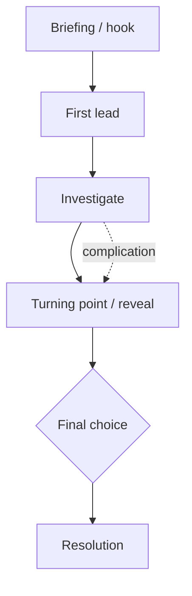

# Silence

## Mission brief
- **Hook:**
- **Objective:**
- **Stakes:**
- **Opening scene:**
- **Resolution:**

## Key elements
- **Locations:**
- **Characters:**
- **Anomalies:**

## Golden path

The intended route through the mission. Add or remove steps and branches as needed.

## GM notes
- **Secrets:**
- **If the agents go off path:**

